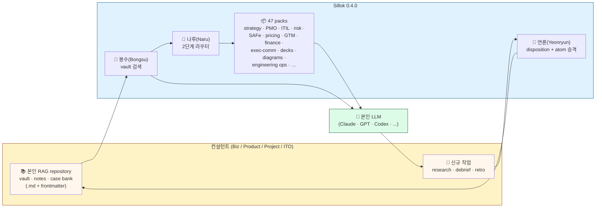
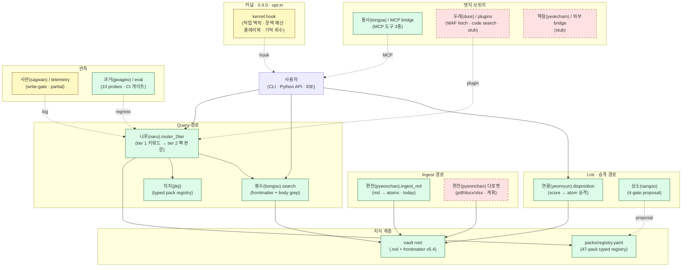

# 실록 (Sillok)

> 2단계 라우팅을 갖춘 제안 전용 LLM 운영체제(Proposal-only LLM Operating System).
> 유네스코 세계기록유산(Memory of the World) 3관왕 — 실록(1997) · 직지(2001) · 장경(2007) — 에서 영감을 받았습니다.

**언어:** [English](README.md) · 한국어

[](https://pypi.org/project/sillok/)
[](LICENSE)
[](https://github.com/sillok-os/sillok/actions)

> **알림**: 본 README는 [영문 README](README.md)의 동격(同格) 한국어판입니다. 코드·로그·CLI 출력 자체는 영어로 통일되어 있으나, 핵심 어휘에 한해 우리 전통 용어 — *실록·나루·봉수·직지·상소·장경·연륜·사관·법전·편찬·과거·마당·두레·통사·역참* — 을 그대로 살려 표기합니다.

> **상태(v0.4.1, 2026-11-19)**: 47 packs(Wave 1: 25 · Wave 2: 18 · Wave 3a: 4) · 실험적 opt-in 커널 관리자 4종 · 10 eval probes · 4-gate 거버넌스 · MCP 브리지 live · 동작하는 통합 `sillok` CLI. 채택 전 기능별 live/partial/stub 매트릭스는 [`STATUS.md`](STATUS.md) 참고. 두 판이 어긋나면 영문판이 정본입니다.
>
> **`0.4.1` 신규** — 팩 Wave 3a: 43 → 47 packs, 새 `research` 분류(학술 논문 작성 · 학술 무결성 검토 · 일상 리서치 · 다축 심층 리서치).
>
> **`0.4.0` 신규** — 메시지 사이에서 동작하는 실험적 opt-in 커널 관리자 4종: `sillok.sacho`(작업 맥락) · `sillok.seungjeongwon`(문맥 예산) · `sillok.gyeongyeon`(플레이북, 기본 shadow) · `sillok.chunchugwan`(기억 회수). Claude Code 훅 하나(`python -m sillok.kernel.hook`)로 묶고, `sillok.eval.evidence`·`sillok.eval.request_coverage`를 더했습니다. 설정하기 전에는 아무것도 동작하지 않습니다 — [F. 커널 관리자](#f-커널-관리자-실험적-opt-in) 참고.
>
> **`0.3.2` 신규** — 팩 Wave 2: 25 → 43 packs(엔지니어링 운영 · 가격·GTM·단위경제·플랫폼 전략 · 덱·다이어그램·이미지 프롬프트·시각 품질 · 건강·여행).
>
> **`0.3.0a1` 이후** — provider-neutral 모듈 7종: `sillok.telemetry.gate`(스키마 강제 telemetry write-gate) · `sillok.sangso.canary`(shadow vs prod KPI canary) · `sillok.yeonryun.coverage`(coverage-gap 탐지) · `sillok.eval.calibration`(Brier confidence 보정) · `sillok.naru.action_layer`(2D 라우팅의 action축) · `sillok.yeonryun.optimizer`(DSPy/GEPA-ready optimizer 인터페이스) · `sillok.eval.probe_seeder`(unlabeled probe seeder). 통합 `sillok` 명령은 이제 `route`/`eval`/`sangso`/`schemas`/`tongsa`를 디스패치합니다. 상소(sangso)·사관(telemetry)·과거(gwageo/eval) 모듈은 더 이상 stub이 아니라 live이며 Wave 2 기능이 더해졌습니다. 자세한 내역: [`CHANGELOG.md`](CHANGELOG.md).

---

## 읽는 순서

본 README 는 **가치 → 활용 → 설치 → 사용 → 유지보수** 흐름으로 구성됩니다. 첫 방문 시 위에서 아래로, 재방문 시 part 단위로 점프하세요.

1. [Part 1 — 가치 / 개요도](#part-1--가치--개요도) — Sillok 이 무엇이며 무엇을 받게 되나
2. [Part 2 — 비즈니스 활용 방안](#part-2--비즈니스-활용-방안) — 본인 역할과 워크플로 매핑
3. [Part 3 — 설치](#part-3--설치) — 요구사항 + 설치 단계
4. [Part 4 — 사용](#part-4--사용) — `0.4.0` 에서 지금 동작하는 것 + 사용법
5. [Part 5 — 유지보수 & 확장](#part-5--유지보수--확장) — 트러블슈팅, 다인원 배포, 본인 도메인 확장
6. [Part 6 — 부록](#part-6--부록) — 라이선스, 선행 연구, 인용

---

## Part 1 — 가치 / 개요도

### 무엇을 받게 되나요

- **47개 프롬프트 팩** 기본 탑재(리서치·학술 논문·전략·PMO·ITIL·리스크·SAFe·거버넌스·임원 보고와 덱·보고서 품질·가격과 GTM·단위경제·플랫폼 전략·엔지니어링 운영·다이어그램과 이미지 프롬프트 등)
- **2단계 라우터** — 결정론적 키워드 매칭으로 팩(들)을 고르고, 고른 팩의 본문만 불러옴(라우팅 중 LLM 호출 없음)
- **5종 retrieval plan ID** — `vault_first`, `vault_then_llmwiki_fallback`, `llmwiki_recovery_first`, `dual_compare`, `no_corpus` (팩이 선언할 수 있음 · 기본 47팩은 아직 선언하지 않음)
- **Reason-coded 출력** — 라우팅 결정마다 R1~R7 태깅(감사 가능)
- **Proposal-only governance** — 4단계 게이트 검토, 무단 덮어쓰기 차단
- **커널 관리자(실험적, opt-in)** — 메시지 사이의 작업 맥락·문맥 예산·플레이북·기억 회수를 Claude Code 훅 하나로 연결
- 라우팅 자체는 **API 키 불필요**. `--execute` 와 키를 추가하면 LLM 호출
- **외부 코퍼스 의존성 없음** — starter 코퍼스와 모든 통합이 `sillok` 안에 포함. 별도 wiki/지식 베이스 도구 설치 불필요

### 한눈에 보는 아키텍처

같은 시스템의 두 시점. 컨설팅 활용 평가 중이라면 **Business view 부터**, 통합 / 확장 / 디버깅 중이라면 **Technical view 부터** 읽으세요.

#### Business view — 컨설턴트가 가치를 얻는 흐름



**한 문장 요약:** 본인 vault 를 Sillok 에 가리키고 → 질문 → 적합한 pack(s) + 관련 atom 자동 선정 → LLM 답변 → 답변이 vault 의 새 atom 으로 환류 → 다음 쿼리 더 똑똑.

#### Technical view — module 데이터 흐름



**범례:** 녹색 = `0.4.0` 에서 `live` · 노랑 = `partial`(코드·테스트는 있고 하위 기능 또는 효과 측정이 빠짐) · 빨강 점선 = stub / 계획. 색은 [`STATUS.md`](STATUS.md) 를 따릅니다.

### Framework 커버리지 — Sillok 이 통합하는 것

Sillok 의 **로드맵** 은 **5축 / 25 카테고리 / 110+ 글로벌 표준** 을 단일 registry · 단일 router · 단일 proposal-only governance 위에서 통합합니다. **`0.4.1` 은 47 packs 를 ship**(Wave 1: 25 · Wave 2: 18 · Wave 3a: 4)하며, 팩이 없는 카테고리는 도메인 기여자에게 열려 있습니다.

```
[축1] 거버넌스         [축2] 딜리버리        [축3] 산업특화          [축4] 비즈니스       [축5] AI/엔지니어링
├─ ERM/EA          ✅  ├─ PMBOK 8        ✅  ├─ 자동차            ⏳ ├─ 전략/BM       ✅ ├─ AI/LLM Eng    ◐
├─ Risk 정량       ◐  ├─ SAFe 6.0       ✅  ├─ 의료기기          ⏳ ├─ M&A/재무      ◐ └─ Prompt 시퀀싱  ✅
├─ ITIL/ITSM       ✅  ├─ 변화관리        ✅  ├─ 금융 은행         ⏳ ├─ SaaS/Pricing/GTM ✅
└─ 보안/컴플       ◐  └─ 조직설계        ⏳  ├─ 보험              ⏳ ├─ 그로스/데이터  ◐ [보조] 출력
                                            └─ 임베디드 SW       ⏳ └─ UX/Discovery  ◐ ├─ 외부 배포      ✅
                                                                                       ├─ 콘텐츠 발행    ⏳
✅ 0.4.0 전용 팩 있음                                                                   ├─ 보고서 품질    ✅
◐ 부분 — 감사 렌즈 또는 한 측면만                                                        ├─ Enterprise B2B ⏳
⏳ 팩 없음 — 기여 환영                                                                   ├─ 디자인 시스템  ◐
                                                                                       └─ 다이어그램/이미지 ✅
```

#### 0.4.1 이 ship 하는 것 (47 packs)

| 영역 | Pack(s) | 프레임워크 / 방법 |
|---|---|---|
| ERM · IT 거버넌스 · EA | `governance-standards` | COSO ERM 2017 · ISO 31000 · COBIT 2019 · TOGAF 10 ADM · Three Lines |
| ITIL · ITSM | `itil-operations` | ITIL v4 · 5-Why + Ishikawa · Blameless PM · BIA · DR runbook |
| 프로젝트 · 포트폴리오 | `pm-enhanced` + `portfolio-governance` + `risk-uncertainty` + `project-charter` | PMBOK 8 · Stage-Gate · Power-Interest · Kraljic |
| SAFe 애자일 | `safe-agile-delivery` | SAFe 6.0 · PI Planning · WSJF · ROAM · Lean Portfolio · I&A |
| 변화관리 · 도구 도입 | `change-management` + `tool-adoption-consulting` | ADKAR · Kotter 8단계 |
| 전략 · 시장 · BM | `consulting-strategy-audit` + `platform-strategy` | Porter 5F · Ansoff · Blue Ocean · BMC · TAM/SAM/SOM · 네트워크 효과 · 콜드 스타트 |
| SaaS · 가격 · GTM | `consulting-saas-audit` + `saas-pricing-packaging` + `gtm-launch-playbook` | 가격 지표 · good-better-best · Van Westendorp · 포지셔닝 캔버스 · 캐즘 |
| 재무 모델링 | `unit-economics-modeling` | CAC / LTV · 회수 기간 · NRR / GRR · Rule of 40 · burn multiple |
| 감사 렌즈 | `consulting-uxui-audit` · `consulting-ai-engineering-audit` · `consulting-security-audit` · `consulting-growth-audit` · `consulting-crossanalysis` | UX · AI/LLM 엔지니어링 · 보안 · 그로스 · 교차 분석 |
| 임원 커뮤니케이션 · 덱 | `exec-communication` + `deck-builder` | Pyramid · SCQA · 10-slide Board · 1-Pager · Sequoia · MD&A |
| 보고서 품질 | `report-quality` | CRAAP · AIMQ · IQF · Bond Triangulation |
| 시각 제작 | `infographic-design` · `design-artifact-production` · `diagram-design` · `visual-quality` · `image-prompt-playbook` · `gpt-image-2-reference` | 다이어그램·인포그래픽 패턴 · 대비 검사 · 이미지 프롬프트 반복 |
| 엔지니어링 운영 | `sw-engineering-operations` · `github-operations` · `github-actions-ops` | 변경 · 리뷰 · CI/CD 운영 |
| 업무 습관 · 메타 | `meeting-minutes` · `worklog` · `agent-1on1` · `pack-maintenance` · `prompt-sequencing-meta` · `cold-domain-grounding` | 회의록 · 업무 기록 · 팩 관리 · 프롬프트 시퀀싱 · 낯선 도메인 근거 확인 |
| 리서치 · 학술 논문 | `research-enhanced` · `deep-research` · `academic-paper-writing` · `academic-integrity-review` | 3축 삼각검증 · 7축 동향 스캔 · STORM식 개요 우선 집필 · 인용 실재·지지 검사 · AI 사용 공개 게이트 · 증거 등급 기반 무결성 검토 |
| 건강 · 여행 (개인) | `everyday-health-symptom` · `running-injury-prevention` · `running-race-data-analysis` · `nutrition` · `travel-trip-planning` | 위험 신호 우선 · 의료 조언 아님 · 결제·예약은 사람이 |

> 📚 **상세 인벤토리** — 25 카테고리 × 110+ 표준 × ship status × persona 페어링 → [`docs/architecture/framework-coverage.md`](docs/architecture/framework-coverage.md).

### Top 10 Features

아래 10가지는 단순 RAG 노트북, Obsidian vault, 1회성 prompt-router 스크립트와 Sillok 을 구분 짓는 능력입니다. Feature 1 이 토대가 되는 루프이고, 나머지는 그 위에 governance·eval·multi-tool 도달 범위를 얹는 계층입니다.

| # | Feature | 무엇을 하나 | 모듈 |
|---|---|---|---|
| 1 | **Multi-format Auto-Ingest RAG** | `md` / `pdf` / `docx` / `xlsx` / `pptx` / `txt` / `hwpx`(한글) 에서 개인 RAG 코퍼스를 자동 구축. 파일 변경(`watch`), 스케줄(`cron`), 또는 on-demand 로 incremental 학습. | `pyeonchan` + `janggyeong` |
| 2 | **Two-Stage Routing** | Tier 1 결정론적 키워드 매칭(LLM 호출 없음) → Tier 2 고른 팩 본문만 로드. 라우터 골든 메시지 59건 기준 47팩 본문 전체를 싣는 것보다 팩 지침 토큰 약 94% 절감(글자/4 추정 · 전체 문맥이 아닌 팩 지침만 비교). ADR 0002 참조. | `naru` |
| 3 | **Typed Pack Registry + 5 Retrieval Plans** | 팩은 `corpus_affinity.retrieval_plan` 을 선언할 수 있고 `bongsu` 가 5종을 지원. 기본 47팩은 아직 선언하지 않음. | `jikji` + `bongsu` |
| 4 | **Proposal-Only 4-Gate Governance** | 자동 성장과 eval 피드백이 시스템 프롬프트나 팩 본문을 절대로 직접 덮어쓰지 않음. 4단계 게이트 통과 필수. | `sangso` |
| 5 | **Multi-Tenant Overlay (스코프 코퍼스)** | 개인 + 팀 + 클라이언트별 vault 가 권한 스코프 계층으로 결합. | `beopjeon` (스코프) + `janggyeong` |
| 6 | **MCP Bridge** | 같은 코퍼스와 팩을 MCP 로 노출 — Claude Code, Cursor, Codex CLI, Continue, ChatGPT Desktop. 도구 lock-in 없음. | `tongsa` |
| 7 | **Plugin System** | 서드파티 능력(WAF-aware fetch, code search, browser automation, doc-fetch) 이 팩처럼 등록 + 선택. fork 불필요. | `dure` |
| 8 | **Eval Golden Probes + KPI Guard** | 6 family × 17-probe 회귀 스위트. CI 게이트: citation 100%, retrieval p50 ≤ 10s, 토큰 ≥ 30% 절감, blind-spot 승격 ≤ 7일. | `gwageo` |
| 9 | **Cross-Tool Plan SSoT** | `docs/plans/<ID>-plan.md` 가 Claude Code, Codex, Cursor 간 공유 — 한 도구에서 plan 시작 + 다른 도구에서 완료. | `madang` + `tongsa` |
| 10 | **Failure Taxonomy + Replay Pointer** | 모든 closeout 이 5-class failure 태그 + replay 좌표 기록. 이력이 학습 가능 데이터로 누적. | `sagwan` + `gwageo` |

> Feature 1 이 나머지 9개를 **복리(複利)** 로 만드는 핵심 루프입니다.

---

## Part 2 — 비즈니스 활용 방안

### Persona 페어링 — 본인 카테고리 빠르게 찾기

본인 역할에 해당하는 행을 찾고, 아래 워크플로 archetype 으로 점프.

| 본인 역할 | 시작할 카테고리 | 도착 |
|---|---|:-:|
| 전략/비즈 컨설턴트 (A1) · 제품 매니저 · CPO/CSO/CEO | **#14 전략/BM** + #16 SaaS + #21 임원 커뮤니케이션 | ✅ today |
| 프로젝트 컨설턴트 (PMP) · PjM/PMO Lead · COO/PfM | **#5 PMBOK** + #6 SAFe + #2 리스크 | ✅ today |
| ITO/ITIL 컨설턴트 · SRE/ITSM · CIO/CISO | **#3 ITIL** + #1 ERM + #4 보안 (예정) | ✅ today |
| Risk 컨설턴트 (FAIR) · Risk Engineer · CRO | **#1 ERM** + #2 리스크 정량 | ✅ + ◐ (`risk-uncertainty`) |
| AI Solution Architect · ML Engineer · CTO/CDO | #19 AI/LLM Eng | ◐ `consulting-ai-engineering-audit` |
| Industry SME (자동차 / 의료 / 금융 / 보험 / 임베디드) | #9~#13 | ⏳ 1.0.0 GA |

> 🤝 **본인 도메인 pack 추가?** 아직 ship 되지 않은 17~18 카테고리는 도메인 SME 분들이 추가하실 수 있도록 의도적으로 비워둔 영역입니다. 단계별 가이드: [`docs/contributing/extending-with-your-domain.md`](docs/contributing/extending-with-your-domain.md).

### 자주 쓰는 워크플로

3 가지 archetype — 컨설팅 / PM / AI 빌더 사용 대부분을 커버.

#### 시니어 컨설턴트
```bash
pip install sillok sillok-mcp
sillok init
sillok corpus install --starter
sillok overlay create --client acme    # 클라이언트 단위 커스터마이징
# 이후 Claude Code / Cursor 안에서 @sillok 사용
```

#### 팀 리드 / 인하우스 PM
```bash
pip install sillok
sillok init --registry https://internal.example.com/sillok-registry.yaml
# init 시점에 사내 표준 pack registry 를 가져옵니다.
```

#### AI 에이전트 빌더
```bash
pip install sillok sillok-mcp
python - <<'EOF'
from sillok import route_message
result = route_message("Phase-2 ERP 롤아웃을 위한 risk register 생성")
print(result.applied_packs)        # ['pm-enhanced', 'risk-uncertainty']
print(result.retrieval_plan)       # 'vault_first'
print(result.confidence)           # 'high'
EOF
```

> 위 워크플로는 **GA 경험** (`>=1.0.0`) 기준. 현재 alpha (`0.4.0`) 에서 지금 동작하는 경로는 [Part 4 — 사용](#part-4--사용) 참조.

---

## Part 3 — 설치

### 요구사항

- **Python 3.11+** (3.12 권장)
- **pip** 또는 **uv**
- macOS 13+ / Ubuntu 22.04+ / Windows 11 + WSL2

선택 사항:
- `ANTHROPIC_API_KEY` 또는 `OPENAI_API_KEY` — 실제 모델 호출 시
- MCP 호환 IDE(Claude Code, Cursor, Continue) — 에디터 내 사용 시
- Docker — 코퍼스를 self-host 하는 경우에만

### 60초 퀵스타트 — *GA 목표*

> **상태(2026-11-17)**: 본 퀵스타트는 **GA 경험**(`>=1.0.0`) 기준입니다. 현재 출시 버전은 `0.4.1` (alpha · 47 packs · 실험적 커널 관리자). today 동작 경로는 [Part 4 — 사용](#part-4--사용) 참조.

```bash
pip install sillok               # 1.0.0+ (GA 목표)
sillok init
sillok route "Acme사 Q3 전략 보고서 작성"

# 예상 출력:
# applied prompt packs: consulting-strategy-audit, exec-communication
# retrieval plan:       vault_first
# confidence:           high (0.91)
# reason codes:         R1 R3
```

라우팅이 동작합니다. 그게 전부입니다.

### 설치 단계

3개 stage. 각 stage 는 이전 단계를 전제. 필요한 만큼만 진행하세요.

#### 1. 기본 설치 — 1인 사용자 (≈ 5분)

```bash
# 설치
pip install sillok

# 작업 폴더 생성 후 초기화
mkdir my-work && cd my-work
sillok init

# 예상 출력:
# ✓ Created .sillok/config.toml
# ✓ Created .sillok/overlay.yaml  (empty — your customizations go here)
# ✓ Created .sillok/state/
# Run `sillok route "<your message>"` to test.

# 첫 라우팅 테스트(LLM 호출 없음)
sillok route "프로덕트팀 분기 OKR 초안"

# 예상 출력:
# applied prompt packs: pm-enhanced, exec-communication
# retrieval plan:       vault_first
# confidence:           high (0.88)
# reason codes:         R1 R3 R4

# 실제 모델 호출(API 키 필요)
export ANTHROPIC_API_KEY=sk-ant-...
sillok route "프로덕트팀 분기 OKR 초안" --execute

# 예상: 라우팅된 시스템 프롬프트로 생성된 모델의 실제 답변
```

기본 워크플로우는 여기까지입니다. starter 팩이 컨설팅·PM·IT 운영의 일상 업무 대부분을 커버합니다.

#### 2. MCP 통합 — IDE (Claude Code / Cursor / Continue, +5분)

**MCP 서버(통사;Tongsa)** 를 통해 IDE 채팅에서 직접 Sillok 라우팅을 사용합니다.

```bash
pip install sillok-mcp
```

**Claude Code** — `~/.claude/settings.json` 또는 프로젝트 `.mcp.json` 에 추가:

```json
{
  "mcpServers": {
    "sillok": {
      "command": "sillok-mcp",
      "args": ["serve", "--stdio"]
    }
  }
}
```

**Cursor** — 같은 형식으로 `~/.cursor/mcp.json` 에 저장.

**Continue** — `docs/integrations/continue.md` 참조.

IDE 재시작 후 채팅에서:

```
> @sillok route "SAP S/4HANA 마이그레이션을 위한 PMO 셋업"
```

```text
# IDE 채팅 예상 출력:
# applied prompt packs: pm-enhanced, safe-agile-delivery, change-management
# retrieval plan:       vault_first
# confidence:           high
# reason codes:         R1 R3
```

저 줄이 보이면 MCP 연결이 완료된 것입니다. 이제 에디터 안의 모든 `@sillok` 요청을 Sillok 이 라우팅합니다.

#### 3. 고급 — RAG 코퍼스(장경;Janggyeong) (+10분)

큐레이션된 지식 코퍼스를 부착해 retrieval 정확도를 끌어올립니다. 옵션을 선택하세요:

**A. 공식 starter 코퍼스 사용** (대부분 사용자 권장)

```bash
sillok corpus install --starter

# 예상 출력:
# Downloading 234 atoms (12 MOC entries)...
# ✓ Installed to ~/.sillok/corpus/
# ✓ FTS5 index built (47 ms)
```

**B. 기존 폴더 연결** (frontmatter v5.4 를 따르는 Markdown 노트)

```bash
sillok corpus link --path /path/to/your/notes

# 예상 출력:
# Validating frontmatter v5.4 ...
# ✓ 412 atoms registered (98% schema-compliant)
# ⚠ 8 atoms skipped (frontmatter incomplete — see corpus.log)
```

> 참고: Sillok 의 코퍼스 포맷은 plain Markdown + YAML frontmatter 스키마입니다. 별도 도구 설치 없이, 스키마를 따르는 어떤 Markdown 폴더라도 동작합니다.

**C. 비어있는 상태로 시작, 누적 축적**

```bash
sillok corpus init --empty
# 큐레이션 파이프라인(편찬;Pyeonchan) 을 통해 작업하면서 atom 이 누적됩니다.
```

동작 확인:

```bash
sillok corpus stats

# 예상 출력:
# Total atoms: 234   (pattern: 78  case: 56  prompt: 41  decision: 28  template: 19  checklist: 12)
# MOC entries: 12
# Last indexed: 2026-04-26 14:30:11

sillok route "B2B SaaS tier-pricing case studies" --show-corpus

# 예상 출력:
# applied packs: saas-pricing-packaging, consulting-strategy-audit
# corpus retrieved (5 atoms):
#   - case/2024-stripe-tier-revamp.md
#   - pattern/value-based-pricing.md
#   - decision/2025-pricing-experiment.md
#   - case/2023-figma-pricing-pivot.md
#   - prompt/saas-pricing-discovery.md
```

---

## Part 4 — 사용

### 컨설턴트 퀵스타트 (0.4.0) — *지금 동작하는 경로*

Biz / Product / Project / IT / ITO 컨설턴트로서 **본인 RAG repository 만 가리키고** 지금 바로 쓰고 싶다면, `0.4.1` 의 전체 사용 경로는 본 섹션입니다(47 packs · Wave 2 모듈 · 실험적 커널 관리자). 통합 `sillok` 명령(`route` / `eval` / `sangso` / `schemas` / `tongsa`)과 **`tongsa` MCP 브리지**(도구 3종)는 동작하며, GA 전용은 `route --execute` 자동 실행뿐입니다. 아래 **Python module CLI** 들도 그대로 씁니다.

#### A. 본인 vault 인덱싱 (5분)

```bash
pip install "sillok>=0.3.1"

# 본인 vault = .md + YAML frontmatter 폴더 어떤 것이든
# (Obsidian · plain notes · docs site · 케이스 뱅크 모두 가능)
python -m sillok.bongsu.search --vault ~/Documents/my-vault --stats

# Frontmatter + body grep (rg → grep fallback):
python -m sillok.bongsu.search --vault ~/Documents/my-vault \
    --scope acme --type pattern --query "pricing" --format full
```

#### B. 쿼리에 맞는 starter pack(s) 선택

```bash
sillok route "Run a strategy audit for Acme with Porter five forces"

# 출력:
# 2-tier router — 'Run a strategy audit for Acme with Porter five forces'
#    tier1 candidates (1):
#      [summary] consulting-strategy-audit           score=  33.5  keyword:Porter
#    tier2 loaded:
#      OK  consulting-strategy-audit           ~ 1768 tokens
```

어느 팩의 트리거에도 걸리지 않는 메시지는 후보를 내지 않습니다(`0.3.1` 부터). `[strategy]` 같은 팩 태그나 도메인 용어를 넣어 방향을 잡으세요.

47 packs 본문은 wheel 안에 동봉됩니다. 체크아웃 밖에서는 라우터가 이 동봉본을 쓰고, 자체 레지스트리를 쓰려면 `SILLOK_REGISTRY=/path/to/registry.yaml` 을 지정합니다:

```bash
python -c "import sillok, pathlib; print(pathlib.Path(sillok.__file__).parent / '_packs')"
# business/  consulting/  core/  engineering/  lifestyle/  methodology/  output-styles/  visual/  registry.yaml
```

#### C. 라우팅된 pack(s) 을 LLM 에 attach (today 는 수동)

통합 `sillok route --execute` 는 GA 목표. Today 는 라우팅된 pack 본문을 직접 LLM 시스템 프롬프트에 복사 — 또는 Claude Code / Cursor / Codex CLI 에서 한 줄로:

```bash
PACKS=$(python -c "import sillok, pathlib; print(pathlib.Path(sillok.__file__).parent / '_packs')")
MSG="Run a strategy audit for Acme with Porter five forces"
for p in $(python -m sillok.naru.router_2tier --message "$MSG" --json | jq -r '.tier2.loaded_packs | keys[]'); do
  find "$PACKS" -name "$p.md" -exec cat {} +
done > system-prompt.md
# system-prompt.md 를 본인 LLM 의 시스템 프롬프트로 사용
```

(GA: `sillok route --execute "..."` 한 번에 처리.)

#### D. 새 산출물 → vault atom 자동 승격

```bash
# 단일 결과 파일 score
python -m sillok.yeonryun.disposition research/2026-04-27-pricing-debrief.md

# 폴더 sweep + auto-extract
python -m sillok.yeonryun.disposition --scan research/ \
    --auto-extract \
    --target-dir ~/Documents/my-vault/40_Knowledge/auto \
    --vault ~/Documents/my-vault \
    --source-repo your-org/playbooks
```

#### E. raw 노트 폴더 자동 ingest (md, today)

```bash
python -m sillok.pyeonchan.ingest_md \
    --vault ~/Documents/my-vault \
    --out ~/.sillok/index.jsonl
```

> Multi-format ingest (`pdf` / `docx` / `xlsx` / `pptx` / `hwpx`) + cron daemon 화는 Pyeonchan Phase 2 계획입니다(일정 미정). 현재는 `.md` + frontmatter 로 표현 가능한 모든 것을 인덱싱합니다.

#### F. 커널 관리자 (실험적, opt-in)

`0.4.0` 은 Claude Code 에서 메시지 사이에 동작하는 관리자 4종을 더했습니다. 코드와 테스트는 있지만 답변 품질에 주는 효과는 통제 시험으로 재지 않았으므로 실험 기능입니다. 훅을 설치하기 전에는 아무것도 동작하지 않고, 작업 맥락·플레이북·기억 회수는 설정에 해당 항목이 있을 때만 돌며, 문맥 예산은 그 관리자들이 만든 블록만 줄입니다.

| 관리자 | 하는 일 | 끄는 법 |
|---|---|---|
| 사초(`sacho`) | 세션이 하는 일의 종류를 턴 사이에 유지(명시 > 최근 쓰기 > 이어받기) | `SILLOK_WORK_CONTEXT=off` |
| 경연(`gyeongyeon`) | 업무 종류별 교훈과 결과 카운터 · `shadow` 로 시작(세기만 하고 보여 주지 않음) | `SILLOK_PLAYBOOK_MODE=off` |
| 춘추관(`chunchugwan`) | 기억 노트·지난 에피소드의 위치만 회수(5줄 이하 · 본문은 안 보냄) | `SILLOK_MEMORY_RECALL=off` |
| 승정원(`seungjeongwon`) | 이번 세션에 이미 보인 블록을 위치 표시로 접음 | `SILLOK_CONTEXT_BUDGET=off` |

```bash
pip install "sillok>=0.4.0"
# examples/kernel/*.json 을 ~/.sillok/ 로 복사한 뒤 경로·업무 종류·플레이북 항목을 고침
echo '{"hook_event_name":"UserPromptSubmit","session_id":"demo","prompt":"fix this failing test"}' \
  | SILLOK_PLAYBOOK_MODE=auto python -m sillok.kernel.hook --config ~/.sillok/kernel.json
```

`.claude/settings.json` 에 연결합니다(`UserPromptSubmit`, matcher `compact` 인 `SessionStart`, 선택으로 `Stop` 훅 `python -m sillok.eval.request_coverage` — 번호 요청 항목을 빠뜨린 답변을 한 번 되돌려 보냄). 전체 예시: [`examples/kernel/README.md`](examples/kernel/README.md).

### 자주 쓰는 명령어 (GA 목표)

```bash
sillok route "<메시지>"                  # 팩 + retrieval plan 선택(LLM 호출 없음)
sillok route "<메시지>" --execute        # 위와 같음 + LLM 호출 후 답변 출력
sillok route "<메시지>" --show-corpus    # 위 + retrieved atom 출력

sillok packs list                        # 사용 가능한 모든 팩
sillok packs info pm-enhanced            # 단일 팩 상세

sillok overlay create --client <name>   # 새 클라이언트/팀 overlay
sillok overlay use <name>                # 현재 셸에서 활성화
sillok overlay list                      # 모든 overlay 표시

sillok corpus stats                      # 코퍼스 헬스
sillok corpus reindex                    # FTS5 인덱스 재구축

sillok eval run --suite router-goldens   # 회귀: router 30 goldens
sillok eval run --suite rag-probes       # 회귀: 17 RAG probes

sillok sync                              # config + registry 드리프트 체크
sillok doctor                            # 일괄 진단 스냅샷
```

모든 명령어는 영문 alias 와 한국어 모듈명을 동시에 받습니다:
```bash
sillok telemetry tail   ≡   sillok sagwan tail
sillok eval run         ≡   sillok gwageo run
```

### 0.4.0 이 **아직** 제공하지 않는 것

| 능력 | 상태 | 도착 |
|---|:-:|:-:|
| `sillok route --execute` (LLM 호출) | ⏳ 미구현 | GA |
| `sillok init` · `corpus` · `overlay` · `packs` · `sync` · `doctor` | ⏳ 미구현 | GA |
| Multi-format ingest (pdf/docx/xlsx/pptx/hwpx) | ⏳ md only | Pyeonchan Phase 2 |
| Multi-tenant overlay 런타임 | ⏳ 스키마만 | 계획 |
| 플러그인 시스템 (`dure`) | ⏳ stub | 계획 |
| 커널 관리자의 답변 효과 | ◐ 코드·테스트 있음 · 효과 미측정 | — |
| 통합 `sillok` 명령 (`route` / `eval` / `sangso` / `schemas` / `tongsa`) | ✅ 출시 (`0.3.0a1`) | 완료 |
| `@sillok` IDE 용 MCP bridge | ✅ 출시 (v0.1.0a7, `tongsa` 도구 3종) | 완료 |
| Proposal-only 4-gate governance executor | ✅ 출시 (v0.1.0a7, `sangso`) | 완료 |
| Eval CI blocking gate | ✅ 출시 (v0.1.0a7, `gwageo` 10-probe v1) | 완료 |

위 항목 중 deal-breaker 가 있다면 alpha 유지 + 마일스톤 watch — §A–E 의 Python module CLI 들은 통합 surface 도착 후에도 그대로 작동.

---

## Part 5 — 유지보수 & 확장

### 트러블슈팅

아래 일부 해결책은 `0.4.0` 에 아직 없는 GA 명령(`init`·`corpus`·`overlay`·`sync`·`doctor`·`config`)을 씁니다 — 위 표 참고.

```text
sillok: command not found
  → pip install --user sillok 후 ~/.local/bin 을 PATH 에 추가

Corpus not found
  → sillok corpus install --starter

MCP server timeout in IDE
  → pip install 'sillok[mcp]' 후 IDE 재시작

Overlay validation failed
  → sillok overlay validate <name>      # 정확한 필드 오류 확인

Drift detected in registry.yaml
  → sillok sync --registry              # 재가져오기 + 조정

Routing slow (>10s)
  → sillok corpus reindex
  → sillok config set discovery_tier 2  # 큰 registry 용 2-tier router

LLM execution fails
  → ANTHROPIC_API_KEY / OPENAI_API_KEY 확인
  → sillok doctor                       # 환경 전체 덤프
```

### 다인원 / 전사 배포

위 안내는 **1인 + 1대 노트북** 기준입니다. 50명 이상이 공용 팩, 공용 코퍼스, RBAC, 감사 등급 governance 가 필요하다면 **모든 노트북에 동일 설치하지 말 것** — 코퍼스가 분기되고 감사 흔적이 사라집니다.

[`docs/enterprise-deployment.md`](docs/enterprise-deployment.md) 를 참고하세요:
- Git 백엔드 공용 코퍼스(복제 없음)
- Multi-tenant overlay scoping
- 중앙 telemetry export(OpenTelemetry → Langfuse / Datadog)
- RBAC + leaver-revocation
- self-approval 방지

엄지 규칙: 사내 10명 이상이 Sillok 을 쓸 예정이라면 위 가이드를 먼저 읽으세요.

### 본인 도메인 pack 추가

47 packs 는 [커버리지 지도](#framework-커버리지--sillok-이-통합하는-것)의 ✅·◐ 카테고리를 다룹니다. 아직 ⏳ 인 카테고리(자동차 / 의료기기 / 은행 / 보험 / 임베디드 / 조직설계 / 콘텐츠 발행 / Enterprise B2B)와 ◐ 인 카테고리(Risk 정량 / 보안 / M&A / 그로스 / UX / AI 엔지니어링 / 디자인 시스템)는 **도메인 SME** 분들이 추가하실 수 있도록 의도적으로 비워 둔 영역입니다.

기여하시려는 도메인이 있다면 전용 가이드가 전체 절차를 다룹니다:

→ [`docs/contributing/extending-with-your-domain.md`](docs/contributing/extending-with-your-domain.md)

pack anatomy, `registry.yaml` entry, **sanitization 체크리스트** (PR 반려의 가장 흔한 원인), 표준 인용 룰 (nominative fair use), framework-coverage 인벤토리 갱신, **5-step quality gate**, 외부 contributor + maintainer SME 양쪽 PR 워크플로 포함.

### Module 레퍼런스 (로그에서 마주칠 때만 참고)

`sillok` 은 단일 패키지입니다. 내부적으로 한국 전통 어휘로 명명된 모듈로 조직됩니다. 도구를 사용하기 위해 외울 필요는 없으나, 매핑은 다음과 같습니다:

```text
나루(naru)          - 2단계 라우팅 (강을 건너는 첫 길목)
봉수(bongsu)        - 5종 retrieval plan + vault 검색 (烽燧, 봉화로 정보를 잇던 신호망)
직지(jikji)         - 팩 레지스트리 (直指, 1377년 세계 최고(最古) 금속활자본 = 인쇄형 표준)
상소(sangso)        - 제안 엔진 / 거버넌스 게이트 (上疏, 임금에게 올린 청원·제안 절차)
장경(janggyeong)    - RAG 코퍼스 (藏經, 팔만대장경 — 큐레이션된 atom 모음)
연륜(yeonryun)      - 자동 메모리 + atom 승격 (年輪, 나이테처럼 누적되는 지식)
사관(sagwan)        - 텔레메트리 / 옵저버빌리티 (史官, 실록을 기록하던 사관)
법전(beopjeon)      - 스키마 (法典, Pydantic — 데이터의 법전)
과거(gwageo)        - eval (科擧, 회귀시험 = 과거시험)
마당(madang)        - CLI 진입점 (마당, 사람이 모이는 공간)
두레(dure)          - 플러그인 프레임워크 (두레, 협업 공동체)
통사(tongsa)        - MCP 서버 / IDE 통합 (通辭, 통역사 — 도구 간 언어 변환)
편찬(pyeonchan)     - 코퍼스 큐레이션 파이프라인 (編纂, 사료를 묶어 책으로 엮음)
역참(yeokcham)      - 외부 브릿지 (驛站, 역참 — 외부 vault·코퍼스로 가는 중계소)
사초(sacho)         - 턴 사이 작업 맥락 (史草, 사관이 남긴 기록의 초고) · 0.4.0 opt-in
승정원(seungjeongwon) - 문맥 예산 (承政院, 왕명 출납을 맡은 기관) · 0.4.0 opt-in
경연(gyeongyeon)    - 업무 종류별 플레이북 (經筵, 임금이 학문을 익히던 자리) · 0.4.0 opt-in
춘추관(chunchugwan) - 기억·에피소드 회수 (春秋館, 실록을 편찬·보관한 관청) · 0.4.0 opt-in
커널(kernel)        - 위 4종을 묶는 Claude Code 훅 · 0.4.0
```

모든 모듈 명령어는 영문 alias 도 가집니다(`sillok telemetry tail` ≡ `sillok sagwan tail`).

---

## Part 6 — 부록

### 라이선스 & 기여

- **소스 코드**: Apache License 2.0 — [`LICENSE`](LICENSE) 참고
- **Starter atoms**(`04-prototypes/janggyeong-starter-atoms/`): Creative Commons Attribution 4.0 (CC BY 4.0) — 별도 라이선스인 교육 콘텐츠
- **상표 / 출처 표기 / 문화적 참조**: [`NOTICE`](NOTICE) — 재배포 전 필독. Sillok 은 PMBOK®, SAFe®, BABOK®, ITIL®, COBIT®, ISO/IEC 표준 등을 nominative fair use 로 참조하며, 어떤 단체와도 제휴 / 보증 관계가 없습니다.
- **기여**: [`CONTRIBUTING.md`](CONTRIBUTING.md) 참고(DCO sign-off 필수) + 새 pack 추가는 [`docs/contributing/extending-with-your-domain.md`](docs/contributing/extending-with-your-domain.md)
- **거버넌스**: [`GOVERNANCE.md`](GOVERNANCE.md) 참고
- **행동 강령**: [`CODE_OF_CONDUCT.md`](CODE_OF_CONDUCT.md) 참고(Contributor Covenant 2.1)
- **이슈**: https://github.com/sillok-os/sillok/issues
- **토론**: https://github.com/sillok-os/sillok/discussions

### 선행 연구 & 영감

Sillok 의 지식 계층은 Andrej Karpathy 가 제안한 **"LLM Wiki" 패턴**([gist, 2026](https://gist.github.com/karpathy/442a6bf555914893e9891c11519de94f)) — 사용자와 raw source 사이에 위치하는 LLM 유지 / 영속 / 상호참조 markdown wiki — 의 제품화 구현입니다.

| Karpathy LLM Wiki | Sillok 모듈 |
|---|---|
| Raw sources (불변) | 사용자의 vault / 노트(코퍼스 외부 보관) |
| The wiki (LLM 생성 markdown) | RAG 코퍼스(장경;Janggyeong) |
| Schema (CLAUDE.md / AGENTS.md) | `CLAUDE.md` + frontmatter v5.4 |
| Ingest | 큐레이션 파이프라인(편찬;Pyeonchan) |
| Query | Retrieval(봉수;Bongsu) |
| Lint | 자동 성장(연륜;Yeonryun) + Eval(과거;Gwageo) |
| `index.md` | 코퍼스 내부의 MOC(Map of Content) |
| `log.md` | Telemetry 로그(사관;Sagwan) |

Sillok 은 패턴 위에 다음을 더합니다: 타입 있는 **pack registry**(직지;Jikji), **2단계 라우팅**(나루;Naru), **proposal-only 4-게이트 governance**(상소;Sangso), **multi-tenant overlay**(법전;Beopjeon scope), 그리고 **유네스코 세계기록유산 3관왕** 브랜드 정체성.

Karpathy 패턴에 이미 익숙하다면, Sillok 은 그 위에 governance · multi-tenant 스코프 · 한국 문화 앵커를 얹은 결과물입니다.

기타 영향: Vannevar Bush 의 **Memex**(1945) — 연상 trail 을 갖춘 개인 큐레이션 지식 — Karpathy 자신도 인용한 출발점.

#### 왜 vault-resident 전용인가 (30시간 ablation)

vault-resident 코퍼스 저장만을 지원하는 결정은 스타일 선택이 아니라 — 10년 묵은 Obsidian vault(45,640 노트)와 fresh Karpathy-style llm-wiki 사이의 30시간 head-to-head ablation 결과입니다(6 query pattern × 5 axis 루브릭 = 96점):

- **Q5(Case Bank Mode)**: vault 가 **0건** 반환한 사이 llm-wiki 는 OneDrive 스캐닝으로 5분 만에 케이스를 찾음 — "구조적 20% blind-spot" 가설을 입증한 16점 격차.
- **Coverage gap**: 45,640 노트 중 13,772(30%) 만이 `vault-search` 인덱싱; 나머지 **31,868 노트(70%) 가 사실상 retrieval 에 invisible** — extraction 전까지.
- **최종 아키텍처**: *vault 를 단일 진실원으로 + Karpathy 패턴이 surface 했을 모든 포맷을 흡수하는 extraction 파이프라인*. 정확히 Sillok 의 `pyeonchan`(Multi-format Auto-Ingest, Top 10 Feature #1)이 구현하는 것.

> 참고: K-6 _"30시간 RAG 실측 회고 — Karpathy 의 llm-wiki 는 내 10년 obsidian-vault 를 이길 수 있었나"_ (projectresearch.co.kr, 2026-04-18, post id 9998).

#### 직접 명세 추적(D-시리즈)

Karpathy 패턴 외에도 Sillok 의 모듈 선택은 agentic engineering 6부작 PM-coach 분석(AX whitepaper 의 **D-시리즈**)과 1:1 대응합니다. 각 D-post 가 미해결 문제를 식별했고, 각 Sillok 모듈이 운영적 답안:

| D-post (projectresearch.co.kr) | 미해결 문제 | Sillok 모듈 / feature |
|---|---|---|
| D-1 _MCP & A2A 프로토콜_ (2026-04, post 10009) | agent-protocol lock-in 방지 | `tongsa` MCP Bridge (Feature #6) |
| D-2 _Agentic PM (PMBOK 8th)_ (post 10010) | AI as Assistance / Augmentation / Automation 3-pattern 통합 | `pm-enhanced` + `safe-agile-delivery` 팩 |
| D-3 _Vibe Coding & Agentic Engineering_ (post 10011) | OWASP Agentic Top 10 (ASI01~ASI10) 게이트 | `claude-code-wat` 팩 + `sangso` 4-게이트 |
| D-4 _Multi-agent topology 선택_ (post 10012) | 코디네이션 비용 소유권 | `tongsa` (MCP Bridge) + `dure` (플러그인 시스템) |
| D-5 _AI-SDLC governance 게이트_ (post 10013) | 품질 약속 → 게이트 배치 | `sangso` proposal-only 4-게이트 (Feature #4) |
| D-6 _RAG 지식 관리_ (post 10014) | 10년 lesson-learned / RAID / 플레이북 재활성화 | `janggyeong` + `pyeonchan` + multi-tenant overlay (Features #1 + #5) |

D-시리즈는 본 코드베이스보다 선행하며, Sillok 의 14개 모듈은 정확히 이 6개 문제를 해소하기 위해 선택되었습니다.

### 인용

연구에 Sillok 을 사용하시는 경우, 프리프린트 인용을 부탁드립니다:

```bibtex
@misc{sillok2026,
  title  = {Sillok: A Proposal-Only LLM Operating System with Two-Stage Routing},
  author = {Kim, Peter and contributors},
  year   = {2026},
  url    = {https://arxiv.org/abs/XXXX.XXXXX}
}

@misc{karpathy2026llmwiki,
  title  = {LLM Wiki},
  author = {Karpathy, Andrej},
  year   = {2026},
  howpublished = {GitHub Gist},
  url    = {https://gist.github.com/karpathy/442a6bf555914893e9891c11519de94f}
}
```

---

*실록(Sillok) = 조선왕조실록(朝鮮王朝實錄). 유네스코 세계기록유산, 1997.*
*5세기 분량의 audit-grade governance 를, 이제는 LLM 을 위해.*
